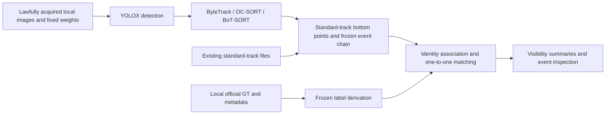

# From inputs to identity-qualified crossing scores

Frozen code retains the scientific computations. Outer entry points handle explicit paths, input contracts and output locations. The stages cover public-development resource reconstruction, cached-track scoring, pixel detection/tracking, diagnostic primitives and confirmation preparation. Each stage has its own dependencies and acceptance scope; CPU self-checks cover the specific cached pathways described below.



The historical YOLOX＋v11 numerical example separately preserves raw-detection-footpoint event semantics. Reproducing that score requires the native artifacts and interface in addition to standard trajectory files. Sources: S20, S21; source definitions appear in [metadata/docs_sources.json](metadata/docs_sources.json).

## 1. Choose the environment and inputs

Run from the repository root. The CPU core reference environment is Python 3.10.18 and NumPy 2.2.6; optional Pillow supports explicitly requested local-image rendering. Print interpreter and NumPy versions, then run synthetic checks:

```text
python -c "import sys,numpy; print(sys.version); print(numpy.__version__)"
python -B scripts/run_resource_synthetic.py
```

This handoff used the existing environment. Collaborators can follow the Windows/POSIX commands in [README](README.md) to create an external environment and install `requirements-cpu.txt`. Replace `python` below with that environment's explicit interpreter path. Detection, tracking and analysis may require additional dependencies; see their requirements files and [portability guide](docs/PIPELINE_PORTABILITY.md). GPU readiness and full real-image inference have separate acceptance gates from CPU readiness.

Replace uppercase path placeholders in the commands. All outputs must use **new, nonexistent files/directories outside the entire repository**, preserving frozen sources and prior results. See [DATA](DATA.md) for data and weight sources. The GT root contains each sequence's `gt/gt.txt`; the metadata root contains each `seqinfo.ini`. Omitting `--seqinfo-root` uses the GT root.

## 2. Label reconstruction and cache regression

```text
python -B scripts/reproduce.py --gt-root GT_TRAIN_ROOT --seqinfo-root SEQINFO_TRAIN_ROOT --out NEW_LABEL_OUT
python -B scripts/score_tracker.py --self-test --gt-root GT_TRAIN_ROOT --seqinfo-root SEQINFO_TRAIN_ROOT --out NEW_PANEL_CHECK_OUT
```

The first command reconstructs development labels and checks the bundled numerical example. The second checks event-score regression for three standard-track examples. Label functions, regions, event rules, identity logic and matching objectives retain their original implementations; outer code adapts the interface. See [metadata/core_frozen_map.json](metadata/core_frozen_map.json) for copied-core provenance.

These commands consume local GT and numerical outputs. Weights and source images belong to later stages. Recorded same-machine cache regression took 39.516 seconds for `reproduce`, with status `COMPLETE_PENDING_INDEPENDENT_REPRODUCTION_AND_HUMAN_QC`, and 167.094 seconds for `score_tracker --self-test`, with all three panel rows PASS. Timings describe that machine. See [VERIFY](VERIFY.md) for checks and receipts; independent acceptance on another machine remains a separate step.

## 3. Standard-track scoring and evidence inspection

The input directory contains exactly `MOT20-01.txt` and `MOT20-02.txt`. Rows follow `frame,id,x,y,w,h,confidence,-1,-1,-1`, with 1-based frame numbers and left/top coordinates. Preserve each frame's original row order. Invalid rows fail and require explicit correction. See [core/README.md](core/README.md) for the full contract and supported scope.

```text
python -B scripts/score_tracker.py --gt-root GT_TRAIN_ROOT --seqinfo-root SEQINFO_TRAIN_ROOT --tracks TRACKS_DIR --name tracker --out NEW_SCORE_OUT
python -B scripts/inspect_event.py --gt-root GT_TRAIN_ROOT --seqinfo-root SEQINFO_TRAIN_ROOT --event-id EVENT_ID --out NEW_REFERENCE_QUERY
python -B scripts/inspect_event.py --gt-root GT_TRAIN_ROOT --seqinfo-root SEQINFO_TRAIN_ROOT --tracks TRACKS_DIR --event-id EVENT_ID --out NEW_SYSTEM_QUERY
python -B scripts/inspect_event.py --gt-root GT_TRAIN_ROOT --seqinfo-root SEQINFO_TRAIN_ROOT --tracks TRACKS_DIR --list-misses --bin low --out NEW_MISS_LIST
```

Obtain EVENT_ID from reconstructed labels or the query list. Queries show reference support, the matching system event, identity votes, time/position residuals, nearby competitors and valid outputs on both sides. Human recognition of the source image has a separate evidence role. Optional `--images LOCAL_IMG1_DIR --render-out ANOTHER_NEW_DIR` renders explicitly supplied local images with Pillow; core scoring can run independently of rendering.

## 4. Generate standard tracks from pixels

Prepare an explicit input manifest according to [configs/pipeline_inputs.schema.json](configs/pipeline_inputs.schema.json) and the [portability guide](docs/PIPELINE_PORTABILITY.md). Bind the development sequence, frame rate, native size, relative weight path/size/SHA and each image's relative path/size/SHA. Relative paths resolve from the manifest directory. The schema and CLI define the accepted values and validation constraints.

```text
python -B scripts/detect.py --manifest PIXEL_INPUT_JSON
python -B scripts/detect.py --manifest PIXEL_INPUT_JSON --out NEW_DETECT_DIR --device cuda:0 --execute
python -B scripts/track.py --cache DETECT_DIR --method byte
python -B scripts/track.py --cache DETECT_DIR --method byte --out NEW_TRACK_DIR --execute
```

Before `--execute`, detection validates manifest structure and tracking validates cache-manifest structure. Image/weight access and cache-row processing begin during explicit execution. Tracking `--method` accepts `byte`, `oc` or `bot`; `bot` additionally requires `--gmc-manifest GMC_JSON` under the stated camera-motion contract.

Detection calls frozen YOLOX code; the three panels call frozen author implementations through the established adapters. Standard tracks use MOTChallenge 1-based coordinates. After processing 01/02 separately, explicitly collect both output files into a new track-input directory and score them under Section 3. YOLOX FP16 and its underlying implementation are numerically nondeterministic; historical paper values are conditional on the sealed cache from that run.

Native v11 has dedicated entry points using approved verbatim function slices, the original MethodTracker, M4 and event extraction/C1/R1/R2:

```text
python -B scripts/native_v11.py --manifest NATIVE_V11_INPUT_JSON
python -B scripts/native_v11.py --manifest NATIVE_V11_INPUT_JSON --out NEW_NATIVE_V11_DIR --execute
```

This entry point preserves raw-detection-footpoint events and actual post-M4 `tracker_rows`. The separate identity-scoring entry point directly consumes these native artifacts:

```text
python -B scripts/score_native_v11.py --native-01 NATIVE_01_DIR --native-02 NATIVE_02_DIR --gt-root GT_TRAIN_ROOT --seqinfo-root SEQINFO_TRAIN_ROOT
python -B scripts/score_native_v11.py --native-01 NATIVE_01_DIR --native-02 NATIVE_02_DIR --gt-root GT_TRAIN_ROOT --seqinfo-root SEQINFO_TRAIN_ROOT --out NEW_NATIVE_SCORE_OUT --execute
```

Default preflight validates only the two `native_manifest.json` files. Frame caches, events, GT and seqinfo are opened during explicit execution, which requires NumPy 2.2.6. It calls frozen label reconstruction, E1-v2 output pools, identity association, matching, optimal ranges and aggregation. Saved `final_events` retain their event semantics, while identities are recomputed from actual post-M4 `tracker_rows`. Historical answers remain outside this computation; historical equivalence has a separate acceptance gate. Outputs include reconstructed labels, identity/matching evidence, stratified numerator/denominator pairs, ranges and a read ledger.

`score_tracker.py` decodes standard-track events under its own semantics; use native scoring for original-footpoint events. The native scoring path passed 10 synthetic checks and initially recorded **`NOT_REAL_DATA_REGRESSED`**. A later development-equivalence receipt recorded **`LOCAL_EQUIVALENCE_PASS_PENDING_CLAUDE_RECOMPUTE`**; see the [status addendum](docs/NATIVE101A_STATUS_ADDENDUM.md). Inspector integration carried forward that receipt. Historical status appears in [native_v11_scoring_status.json](metadata/native_v11_scoring_status.json), interface details in [PIPELINE_PORTABILITY](docs/PIPELINE_PORTABILITY.md), and executed acceptance in [VERIFY](VERIFY.md). Full GPU execution remained pending in that snapshot. ReID #93's appearance-inference driver has its own implementation and acceptance requirements beyond the supplied weight source and decision primitives. Sources: S32–S34 in [docs_sources](metadata/docs_sources.json).

## 5. Diagnostic primitives and one-time confirmation

`scripts/analysis.py` exposes frozen computations with explicit JSON inputs:

```text
python -B scripts/analysis.py --help
python -B scripts/analysis.py ACTION --input INPUT_JSON --out NEW_EXTERNAL_JSON
```

ACTION accepts `e2-mask`, `d1-gaps`, `headgate-project`, `gatelink`, `e1-pools`, `e1-attribute`, `m4-stitch`, `reid-decision` and `reid-support`. Each action covers its specified primitive. An E2 mask feeds a larger deletion/tracking/decoding/scoring grid; M4 stitching is one stage of native v11; HeadGate projection is part of the historical diagnostics; ReID decision/side-support operates on supplied evidence while appearance inference has its own driver. The portability guide defines inputs and call boundaries. Stopped research claims retain the decisions recorded in HISTORY.

Historical 03/05 confirmation and independent score recomputation are complete, with values in [RESULTS](RESULTS.md). The repository's confirmation tool checks deployment contracts and generates explicit commands. Preparation and execution are separate steps:

```text
python -B scripts/confirm.py --help
python -B scripts/confirm.py --workspace EXTERNAL_WORKSPACE --manifest docs/manifest.json --manifest-sha256 MANIFEST_SHA256 --approval docs/approval.json --approval-sha256 APPROVAL_SHA256 --out data/r15/confirmation85/commands
```

`EXTERNAL_WORKSPACE` must be outside the repository. The wrapper deploys five original modules at their original relative locations, preserving the actual guard, schema and steps. Example `docs/...` inputs and the `data/...` command directory resolve within that external workspace. Users supply the manifest, approval and full SHA256 values under the protocol. A synthetic check of the real guard generated 18 scientific-stage commands plus collect; worker execution remained outside that check. See [PIPELINE_PORTABILITY](docs/PIPELINE_PORTABILITY.md) for the full contract. Data discovery, cache selection, additional confirmation and threshold changes each require explicit scope and authorization. Sealed data remain outside the package; 03/05 inference and scoring retained their historical execution evidence during handoff.

## 6. Assess handoff readiness

Start with synthetic checks, then use lawfully acquired development inputs for CPU label and cache regression. Pixel-to-track acceptance additionally requires weights, images, GMC, dependencies and recorded new outputs. Independent acceptance then requires another machine to follow the same instructions and record its results. Maintain a separate receipt for each layer.

[PIPELINE_PATCHDIFF](docs/PIPELINE_PATCHDIFF.md) and [pipeline_frozen_map](metadata/pipeline_frozen_map.json) record source copies and adaptations; execution acceptance is documented separately. Data and third-party code retain their own licenses. Q2/Q3 human review follows `protocols/human_qc/` and `review/`. Label QC, cross-machine acceptance, rights/attribution and hosted-access checks each have their own completion gates.

